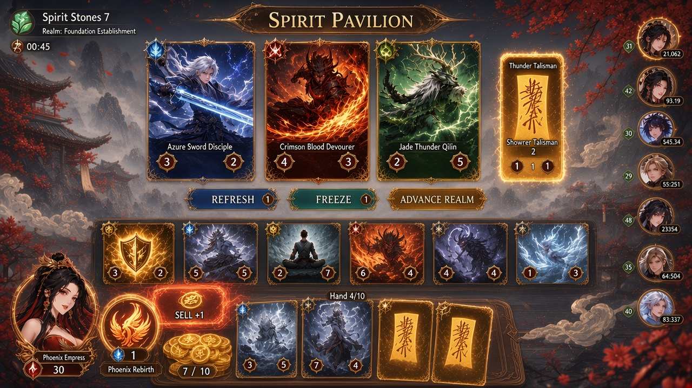

# Dao Chess

Dao Chess is a xianxia-themed, Hearthstone Battlegrounds-style auto-battler for Android. Play is landscape and phone-first.

Five tribes share the shop: Righteous Sect, Demonic Sect, Rogue Cultivator, Spirit Beast, and Alchemist Association. Heroes each have a hero power. Cultivation realms are the shop tiers.

Version 1 is single-player against AI bots. Async ghost lobbies come later. The game is free to play, with a $4.99 cosmetic-only pass.

## Shop mockup

Approved art-style and UI mockup of the recruit phase (Spirit Pavilion): anime xianxia style, a shop row, a board with attack and health on every creature, a hand tray (4/10), a sell zone, a coin counter (7/10), and a hero portrait with a hero power button.

Small text in the image is AI-generated and partly garbled. The mockup is for style and layout only.

## Design spec

Rules, economy, tribes, keywords, heroes, combat, and open questions: [docs/SPEC.md](docs/SPEC.md). Every number in the spec is a starting draft for tuning.
